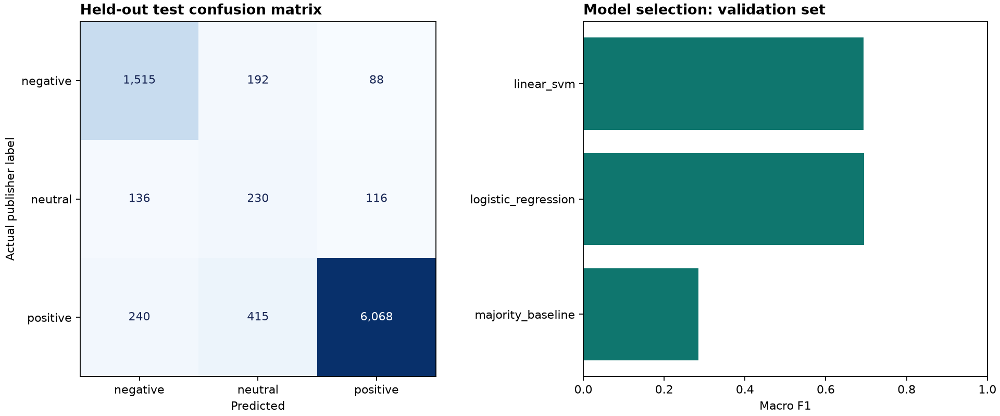

# Flipkart Sentiment Analysis

**TF-IDF · Linear SVM · Logistic Regression | 45,000 unique review texts**

A reproducible sentiment-classification pipeline using public Flipkart product reviews. It compares a majority baseline, Logistic Regression, and a linear SVM, selects the model using validation macro F1, and reports held-out performance with class-level diagnostics.



| Metric | Measured result |
|---|---:|
| Downloaded review rows | 205,052 |
| Unique usable texts after cleaning | 91,814 |
| Stratified sample | 45,000 |
| Training / validation / test rows | 27,000 / 9,000 / 9,000 |
| Selected model | Logistic Regression |
| Test accuracy | **86.81%** |
| Test macro F1 | **0.7016** |
| Test weighted F1 | 0.8802 |

Macro F1 exposes the difficulty of the minority neutral class; accuracy alone conceals it. The SVM had higher validation accuracy, while Logistic Regression won on the predeclared validation macro F1 selection rule.

## Reproduce

Published outputs were generated with Python 3.13 and scikit-learn 1.9.0. From the repository root:

```bash
python3 -m venv .venv
source .venv/bin/activate
pip install -r requirements-dev.txt
python -m src.download
python -m src.train
python -m src.predict "Excellent quality and fast delivery"
python -m src.predict "The product broke immediately and support was terrible"
python -m pytest -q
```

The downloaded archive contains `Dataset-SA.csv`; the extracted file is about 33 MB. The source SHA-256 is checked before training. The raw dataset is not committed. The trained `artifacts/sentiment.joblib` stores preprocessing, vocabulary, IDF weights, and classifier together. Use locally trained or otherwise trusted joblib files. Run commands from the repository root so the `src` package is importable.

For a custom CSV with `Summary` and `Sentiment` columns: `python -m src.train --input /path/to/reviews.csv --sample-size 45000`. Accepted labels are `negative`, `neutral`, and `positive`; enough unique usable texts are required to meet the requested sample size and stratified split.

## Pipeline

1. Load the full public source; retain nonempty review summaries and supported labels.
2. Normalize Unicode, lowercase, expand English negation, remove URLs/punctuation/digits, and collapse whitespace.
3. Remove normalized texts assigned conflicting labels and deduplicate normalized review text **before** sampling and splitting.
4. Sort by normalized-text SHA-256 and select a reproducible stratified 45K sample with seed 42.
5. Split 60/20/20 into training, validation, and test partitions. Exact normalized text cannot cross partitions.
6. Fit TF-IDF only within each candidate's training pipeline: tokenization, English stop-word filtering while preserving negators, unigrams/bigrams, minimum document frequency 2, sublinear TF, at most 80K features.
7. Select Logistic Regression or SVM by validation macro F1; refit the selected pipeline on training + validation; evaluate it once on the untouched test partition.
8. Export metrics, confusion matrix, top weighted features, hash-only split/prediction manifests, and a fitted pipeline for inference.

Ratings, prices, product names, and original sentiment values are never model input features.

## Model comparison

| Candidate | Validation accuracy | Validation macro F1 |
|---|---:|---:|
| Majority baseline | 74.70% | 0.2851 |
| Logistic Regression | 86.01% | **0.6954** |
| Linear SVM | 88.39% | 0.6939 |

The final test uses the selected, refitted model. See [metrics.json](reports/metrics.json), [confusion matrix](reports/confusion_matrix.csv), [top features](reports/top_features.csv), and [findings](reports/findings.md). Test predictions and split manifests contain hashes rather than review text.

## Dataset and evaluation limits

Original source: [Flipkart Product reviews with sentiment Dataset, Nirali Vaghani and collaborator](https://www.kaggle.com/datasets/niraliivaghani/flipkart-product-customer-reviews-dataset). The publisher describes 205,053 rows; the parsed downloaded CSV contains **205,052 data records** excluding its header. The publisher generated sentiment labels from `Summary` using VADER and manual checking. These are weak labels rather than independently collected human annotations, so evaluation measures agreement with the publisher's labeling procedure.

The evaluation is a random, in-domain split. Exact normalized duplicates cannot leak across partitions, but near-duplicate language and products may occur across them. This does not establish performance on unseen products, future reviews, other languages, or independently human-labeled sentiment. The Wilson accuracy interval assumes independent reviews and may be optimistic when language clusters by product. No fixed accuracy target was forced.

## Repository guide

| Path | Purpose |
|---|---|
| `src/download.py`, `data/sources.json` | Verified public-data acquisition and attribution |
| `src/text.py`, `src/train.py` | Text preparation, evaluation, feature interpretation |
| `src/predict.py`, `artifacts/` | Command-line inference and fitted model |
| `data/processed/` | Review hashes, partition membership, held-out predictions |
| `reports/` | Measured results, chart, confusion matrix, feature coefficients |
| `tests/` | Negation, duplicates/conflicts, vocabulary leakage, metric behavior |

See [data provenance](docs/DATA.md) and [resume bullets](docs/RESUME.md). Original code is MIT; the source database and derived outputs retain the original dataset's ODbL/DbCL terms.

## Continuous integration template

A ready-to-use [GitHub Actions template](docs/ci-template.yml) is included. The publishing login lacked GitHub’s `workflow` permission, so it is stored as documentation instead of an active workflow. After granting that permission, place it at `.github/workflows/ci.yml` to enable automated tests. All tests were run locally for this build.
